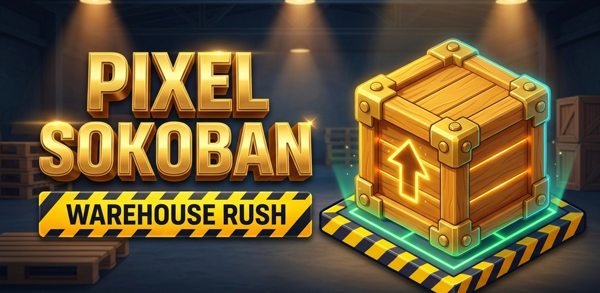

<p align="center">
  
</p>

<h1 align="center">Pixel Sokoban: Warehouse Rush</h1>

<p align="center">
  <em>A high-tactile, retro-industrial Sokoban puzzle experience built with Godot 4.7.</em>
</p>

<p align="center">
  
  
  
  
  
  
</p>

---

## 📖 Overview

**Pixel Sokoban: Warehouse Rush** is a modern reimagining of the classic Japanese box-pushing puzzle genre. Step into the steel-toe boots of an industrial warehouse technician navigating 50 algorithmically validated, non-square warehouse layouts. 

Carefully chart your path through tight warehouse corridors, position crates onto hydraulic goal docks, collect stars, avoid catastrophic deadlocks, and unlock a rich collection of worker skins and custom crates in the **Supply Depot**.

---

## ✨ Key Features

### 📦 50 Handcrafted & Solvable Levels
- **3 Industrial Sectors**: Progressive challenge curve ranging from introductory warehouse bays to high-density logistics complexes.
- **Dynamic Non-Square Framing**: Adaptive camera auto-centering with zero wasted screen space, slim bezel framing, and custom safe-area margins for modern notch/pill displays.
- **3-Star Performance Rating**: Earn stars on every level based on optimal move counts and push efficiency.

### 💡 High-Performance BFS Solver & Hint Engine
- **Instant Step-by-Step Guidance**: Powered by a custom bidirectional Breadth-First Search solver executing in `< 0.1ms`.
- **Proactive Deadlock Detection**: Real-time corner and boundary analysis instantly alerts players before committing irreversible blunders.

### 🏭 Supply Depot & Live Cosmetic Stage
- **Worker Wardrobe**: Unlock outfits including *Classic Denim*, *Workshop Mechanic*, *Safety Vest*, and *Hazmat Specialist*.
- **Industrial Crates**: Push premium cargo containers such as *Classic Pine*, *Reinforced Steel*, *Cryo Container*, and the gilded *Executive Safe*.
- **Real-Time 2.5D Preview Stage**: Dynamic live animation viewport rendering character idle bounces, directional walk cycles, and hydraulic goal-docking particle effects.

### 🏆 Achievements & Milestones
- **9 Unlockable Achievements**: Dedicated modal tracking progression milestones (*First Push*, *Docking Pro*, *Speed Porter*, *Locker Enthusiast*, and more).
- **Juiced Celebrations**: Confetti particle cascades, animated counter ribbons, and glowing completion badges.

### 🌍 Trilingual Native Localization
- Full language support across the entire interface:
  - 🇬🇧 **English**
  - 🇫🇷 **Français**
  - 🇸🇦 **العربية** (Complete bidirectional Right-to-Left / RTL layout and text shaping)
- Quick one-tap language cycling from the main menu top bar.

### 🎮 Arcade Polish & Game Feel
- **Spring Physics**: Responsive, bouncy button animations on hover, focus, and press.
- **Hardware Blur Backdrops**: GPU-accelerated mipmap screen blur shaders (`blur_backdrop.gdshader`) with tap-to-dismiss modal interaction.
- **Synthesized Audio & Haptics**: Procedural push skid noise, pneumatic goal locks, and multi-tier Android vibration patterns.
- **Versatile Controls**: Touch gestures (Swipe), Virtual D-Pad, and Dual Control schemes for seamless touch and keyboard/gamepad navigation.

---

## 🗂️ Codebase Architecture

```
godot/
├── assets/                  # High-resolution textures, pixel art, audio, and themes
│   ├── icons/               # Crisp vector-generated SVG icons (64x64, 256x256)
│   ├── theme.tres           # Master UI theme and StyleBoxFlat component styling
│   └── warehouse_bg.jpg     # Atmospheric warehouse backdrop
├── scenes/                  # Scene definitions and view controllers
│   ├── splash_screen.tscn   # Animated retro splash sequence
│   ├── main_menu.tscn       # 3-tier main menu, level grid, modals, and preview stage
│   ├── game.tscn            # Core game viewport, HUD ribbons, and pause menu
│   └── end_screen.tscn      # Campaign victory celebration screen
├── scripts/                 # Core engine logic and manager singletons
│   ├── main_menu.gd         # Menu state machine, animations, and modal managers
│   ├── game.gd              # Gameplay coordinator, move execution, and win validation
│   ├── sokoban_solver.gd    # High-speed BFS solver and deadlock detection engine
│   ├── save_manager.gd      # Persistent JSON storage, star counts, and cosmetics
│   ├── audio_manager.gd     # SFX synthesis, background music loops, and volume bus
│   ├── localization_manager.gd # Trilingual lookup dictionary and RTL management
│   └── haptic_manager.gd    # Android vibration patterns and fallback handlers
├── shaders/                 # GLSL canvas shaders
│   ├── blur_backdrop.gdshader # Screen texture mipmap blur with vignette tint
│   └── crt_vignette.gdshader  # Retro arcade monitor curve and chromatic aberration
├── tests/                   # 19 automated headless test suites
└── tools/                   # Asset generation, icon renderers, and level solvers
```

---

## 🧪 Automated Test Suite

The project includes **19 headless test suites** covering all critical gameplay logic, solvers, localization, and UI states.

To run the full test suite headless:

```bash
# Run all 19 test suites sequentially
for test in tests/test_*.gd; do
    godot --headless --script "$test"
done
```

Or run individual suites:

```bash
# Verify Sokoban solver and deadlock engine
godot --headless --script tests/test_solver.gd

# Verify Main Menu, Supply Depot, and modal lifecycles
godot --headless --script tests/test_main_menu.gd

# Verify trilingual translations and RTL detection
godot --headless --script tests/test_localization.gd
```

---

## 🚀 Getting Started

### Prerequisites
- **Godot Engine 4.7+** (Standard or .NET build)
- **Linux / macOS / Windows**

### Running Locally
1. Clone the repository:
   ```bash
   git clone git@github.com:0xsnowZ/pixel-sokoban-warehouse-rush.git
   cd pixel-sokoban-warehouse-rush
   ```
2. Open the project in Godot:
   ```bash
   godot -e
   ```
3. Run the project:
   ```bash
   godot
   ```

### Building for Android
1. Configure Android Build Templates and SDK paths in Godot Editor Settings.
2. Export using the configured preset:
   ```bash
   godot --headless --export-release "Android" build/PixelSokoban.apk
   ```

---

## ⌨️ Controls

| Action | Touch / Gesture | Keyboard | Gamepad |
| :--- | :--- | :--- | :--- |
| **Move / Push** | Swipe / Virtual D-Pad | `W` `A` `S` `D` / Arrow Keys | D-Pad / Left Stick |
| **Undo Move** | Tap "Undo" Button | `Z` / `U` / `Ctrl+Z` | `B` / `Circle` |
| **Reset Level** | Tap "Restart" Button | `R` | `Y` / `Triangle` |
| **Hint (BFS)** | Tap "Hint" Button | `H` | `X` / `Square` |
| **Pause Menu** | Tap "Pause" / Gear | `Escape` | `Start` |

---

## 📄 License

This project is licensed under the **MIT License**. See the [LICENSE](LICENSE) file for details.

